 

## ◢ Sobre mim

Desenvolvedor **Full Stack** na **Getel Tecnologia**, onde construo sistemas de gestão de ponta a ponta, do modelo de dados à interface. No back-end, trabalho no dia a dia com **Node.js e NestJS**, além de **Java e Spring Boot**; no front, com **TypeScript, React e Next.js**. Uso IA (**Claude** e **ChatGPT**) como parte do meu fluxo de desenvolvimento. Gosto de software que resolve problema de negócio de verdade: ERPs, CRMs, controle de ponto e estoque.

- 🏢 &nbsp;Full Stack Developer @ **Getel Tecnologia**
- 🎓 &nbsp;Cursando **Técnico em Desenvolvimento de Sistemas** no SENAC, onde desenvolvi o [**HoraControl**](https://github.com/GabrielCardossso/HoraControl) (controle de ponto com Spring Security)
- 🚀 &nbsp;Projeto pessoal: [**EsteticaFlow**](https://github.com/GabrielCardossso/esteticaFlow) (ERP SaaS para estética automotiva)
- 📍 &nbsp;Tubarão · SC · Brasil

## ◢ Stack

<table>
  <tr>
    <td><b>Linguagens</b></td>
    <td></td>
  </tr>
  <tr>
    <td><b>Front-end</b></td>
    <td></td>
  </tr>
  <tr>
    <td><b>Back-end</b></td>
    <td></td>
  </tr>
  <tr>
    <td><b>Dados</b></td>
    <td></td>
  </tr>
  <tr>
    <td><b>Ferramentas</b></td>
    <td></td>
  </tr>
  <tr>
    <td><b>IA</b></td>
    <td></td>
  </tr>
</table>

## ◢ Code DNA

<!-- code-dna:start -->

Ver os números do ranking

| # | Linguagem | Linhas escritas | Participação |
| :-: | :-- | --: | --: |
| 1 | TypeScript | 26.675 | 32,1% |
| 2 | Java | 16.627 | 20,0% |
| 3 | CSS | 9.285 | 11,2% |
| 4 | C# | 8.346 | 10,0% |
| 5 | JavaScript | 7.245 | 8,7% |

194 commits em 13 repositórios · lockfiles, dependências e arquivos gerados ficam de fora · atualizado em 27/10/2026

<!-- code-dna:end -->

## ◢ Contribuições

<picture>
  <source media="(prefers-color-scheme: dark)" srcset="https://raw.githubusercontent.com/GabrielCardossso/GabrielCardossso/output/snake-dark.svg" />
  
</picture>

## ◢ Contato

  
  
  
  

